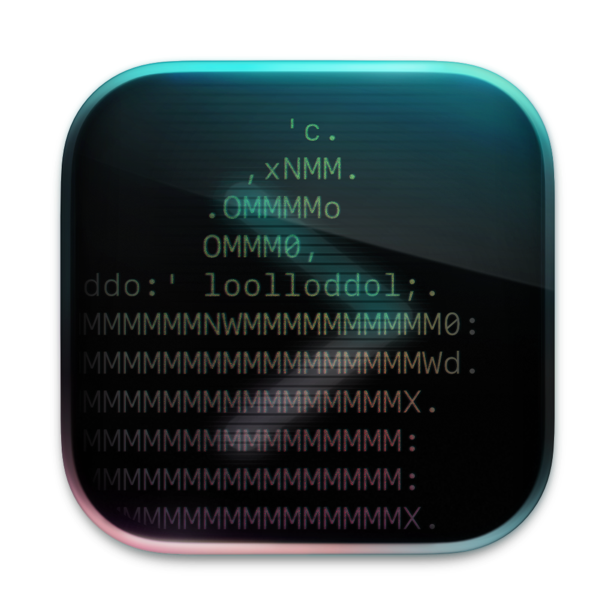
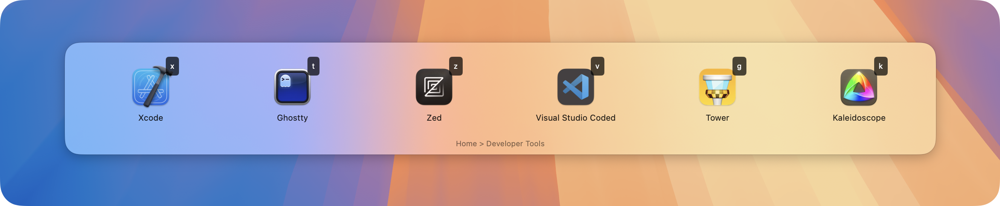

[](https://github.com/amebalabs/SwiftKey/blob/master/LICENSE)
[](https://github.com/amebalabs/SwiftKey/releases/latest)
[](https://www.apple.com/macos/)

<p align="center">
    <a href="https://swiftkey.app"></a>
    <h1 align="center"><code style="text-shadow: 0px 3px 10px rgba(8, 0, 6, 0.35); font-size: 3rem; font-family: ui-monospace, Menlo, monospace; font-weight: 800; background: transparent; color: #4d3e56; padding: 0.2rem 0.2rem; border-radius: 6px">SwiftKey</code></h1>
    <h4 align="center" style="padding: 0; margin: 0; font-family: ui-monospace, monospace;">Hackable Launcher</h4>
    <h6 align="center" style="padding: 0; margin: 0; font-family: ui-monospace, monospace; font-weight: 400;">Right at your fingertips</h6>
</p>

<p align="center">
    <a href="https://swiftkey.app"></a>
</p>

## Overview

SwiftKey is a powerful macOS productivity tool that provides quick access to applications, shortcuts, and custom actions through customizable keyboard shortcuts and an elegant overlay interface.

### Installation

- Download the app from the [Releases](https://github.com/amebalabs/SwiftKey/releases/latest) and drag it to your `Applications` folder
- ...or install with Homebrew:
```bash
 brew tap melonamin/formulae
 brew install swiftkey
```

## Features
- 🎯 Multiple overlay styles:
  - Panel mode with horizontal/vertical layouts
  - HUD mode for a compact interface
  - Menu bar mode for minimal interference
  - Corner Toast for unobtrusive notifications
- ⌨️ Fully keyboard-driven interface:
  - Any key can be the main hotkey, alone or with modifiers (for example `Home` or `F13`)
  - Keys work with any keyboard layout, with the local letter shown as a hint
  - Type a sequence quickly and the menu never appears
- 🔎 launcha: search your menu, apps and files by name, with a built-in calculator
- 🧩 Micro-apps: small YAML tools of shell, Python, HTTP and AI steps
- 🛡️ Commands run only after you approve their exact text
- 🔧 YAML-based configuration
- 🔄 Dynamic menu generation
- 🚀 Support for various action types:
  - Launch applications
  - Open URLs
  - Run shell commands
  - Execute Apple Shortcuts
  - Run micro-apps
- 🎨 SF Symbols integration for menu icons
- 🔍 Deep linking support
- 📦 Automatic updates with beta channel support

## Installation
1. Download the latest release from the Releases page
2. Move SwiftKey.app to your Applications folder
3. Launch SwiftKey and follow the onboarding process

## Configuration
SwiftKey uses YAML for configuration. Here's a comprehensive set of examples demonstrating all available options and common use cases:

### Basic Configuration

```yaml
# Simplest example - just key, title, and action
- key: "c"
  title: "Launch Calculator"
  action: "launch:///System/Applications/Calculator.app"

# With custom icon (from SF Symbols)
- key: "n"
  icon: "note.text"
  title: "Launch Notes"
  action: "launch:///System/Applications/Notes.app"
```

### Submenu Examples

```yaml
# Basic submenu
- key: "b"
  icon: "bookmark.fill"
  title: "Bookmarks"
  submenu:
    - key: "t"
      title: "TechCrunch"
      action: "open://https://techcrunch.com"
    - key: "v"
      title: "The Verge"
      action: "open://https://www.theverge.com"

# Nested submenus
- key: "d"
  icon: "folder.fill"
  title: "Development"
  submenu:
    - key: "e"
      title: "Editors"
      submenu:
        - key: "v"
          title: "VS Code"
          action: "launch:///Applications/Visual Studio Code.app"
        - key: "x"
          title: "Xcode"
          action: "launch:///Applications/Xcode.app"
    - key: "t"
      title: "Terminal"
      action: "launch:///System/Applications/Terminal.app"
```

### Batch Mode

```yaml
# Batch mode - all items in submenu will execute when selecting this item
# Using batch: true flag
- key: "s"
  icon: "bolt.fill"
  title: "Start Workflow"
  batch: true  # Execute all submenu items at once
  submenu:
    - key: "1"
      title: "Open Mail"
      action: "launch:///System/Applications/Mail.app"
    - key: "2"
      title: "Open Calendar"
      action: "launch:///System/Applications/Calendar.app"
    - key: "3"
      title: "Open Slack"
      action: "launch:///Applications/Slack.app"

# Alternative: Press and hold Option (⌥) key when selecting any submenu
# to execute all items in batch mode
```

### Sticky Items

```yaml
# Sticky items - UI stays open after execution
- key: "v"
  icon: "volume.3.fill"
  title: "Volume Up"
  action: "shell://osascript -e 'set volume output volume (output volume of (get volume settings) + 10)'"
  sticky: true  # UI stays open after executing this action

- key: "m"
  icon: "volume.fill"
  title: "Mute Toggle"
  action: "shell://osascript -e 'set volume output muted (not output muted of (get volume settings))'"
  sticky: true

# Alternative: Press and hold Option (⌥) key when selecting any item
# to invert its sticky behavior (non-sticky items become sticky and vice versa)
```


### Notifications

```yaml
# Show notification after execution
- key: "r"
  icon: "text.append"
  title: "Run Script"
  action: "shell://~/scripts/update_database.sh"
  notify: true  # Show notification when script completes
```

### Hidden Items

```yaml
# Hidden items - not shown in UI but can be activated with key or hotkey
- key: "h"
  title: "Hidden Action"
  action: "shell://say 'Secret action activated'"
  hidden: true
  hotkey: "cmd+shift+h"

# Single hidden item in submenu will still be shown despite being hidden
- key: "s"
  title: "Special Menu"
  submenu:
    - key: "x"
      title: "Only Item (Hidden but Still Shown)"
      action: "shell://say 'I am shown because I am the only item in this submenu'"
      hidden: true
```

### Dynamic Menus

```yaml
# Dynamic menu - content generated by a script
- key: "p"
  icon: "terminal"
  title: "Running Processes"
  action: "dynamic://dynamic_menu.sh"
```

### Global Hotkeys

```yaml
# Global hotkey for direct action
- key: "c"
  title: "Launch Calculator"
  action: "launch:///Applications/Calculator.app"
  hotkey: "cmd+ctrl+c"  # Global shortcut: Cmd+Ctrl+C

# Global hotkey to open specific submenu
- key: "d"
  title: "Development Tools"
  hotkey: "cmd+shift+d"  # Global shortcut: Cmd+Shift+D
  submenu:
    - key: "1"
      title: "VS Code"
      action: "launch:///Applications/Visual Studio Code.app"
    - key: "2"
      title: "Terminal"
      action: "launch:///System/Applications/Terminal.app"
```

### Practical Use Cases

```yaml
# Developer Workflow
- key: "d"
  icon: "hammer.fill"
  title: "Developer Tools"
  submenu:
    - key: "c"
      title: "VS Code"
      action: "launch:///Applications/Visual Studio Code.app"
    - key: "g"
      title: "Git Operations"
      submenu:
        - key: "s"
          title: "Git Status"
          action: "shell://'cd ~/projects/current && git status'"
          notify: true
        - key: "p"
          title: "Git Pull"
          action: "shell://'cd ~/projects/current && git pull'"
          notify: true
    - key: "b"
      title: "Build Project"
      action: "shell://'cd ~/projects/current && make build'"
      notify: true
    - key: "t"
      title: "Run Tests"
      action: "shell://'cd ~/projects/current && make test'"
      notify: true

# System Administration
- key: "s"
  icon: "gear"
  title: "System Tools"
  submenu:
    - key: "d"
      title: "Show Disk Usage"
      action: "shell://'df -h | grep /dev/disk1s1'"
      sticky: true
      notify: true
    - key: "m"
      title: "Show Memory Usage"
      action: "shell://'top -l 1 | grep PhysMem'"
      sticky: true
      notify: true
    - key: "n"
      title: "Network Tools"
      submenu:
        - key: "i"
          title: "External IP"
          action: "shell://'curl -s ifconfig.me'"
          sticky: true
          notify: true
        - key: "p"
          title: "Ping Google"
          action: "shell://'ping -c 4 google.com'"
          sticky: true
          notify: true
    - key: "r"
      title: "Restart Services"
      batch: true
      submenu:
        - key: "1"
          title: "Restart DNS"
          action: "shell://'sudo killall -HUP mDNSResponder'"
          notify: true
        - key: "2"
          title: "Flush DNS Cache"
          action: "shell://'sudo dscacheutil -flushcache'"
          notify: true

# Quick Actions
- key: "q"
  icon: "bolt.fill"
  title: "Quick Actions"
  submenu:
    - key: "e"
      title: "Empty Trash"
      action: "shell://'osascript -e \"tell application Finder to empty trash\"'"
      notify: true
    - key: "c"
      title: "Copy SSH Key"
      action: "shell://'pbcopy < ~/.ssh/id_rsa.pub && echo \"SSH key copied to clipboard\"'"
      notify: true
    - key: "s"
      title: "Take Screenshot"
      action: "shell://'screencapture -i ~/Desktop/screenshot-$(date +%Y%m%d-%H%M%S).png'"
      notify: true
```

### Micro-apps

```yaml
# Run a micro-app from micro/greet.yaml next to the config file
- key: "m"
  icon: "sparkles"
  title: "Greet"
  action: "micro://greet"
```

## Action Types
- `launch://` — Launch applications, by path or bundle identifier (`launch://com.apple.Safari`); a running app comes to the front
- `open://` — Open URLs
- `shell://` — Execute shell commands
- `shortcut://` — Run Apple Shortcuts
- `dynamic://` — Generate dynamic menus
- `micro://` — Run a micro-app by its id

## Menu Item Properties
- `key` — Trigger key: one character (`a` and `A` are different keys; `A` is typed with Shift), or `space`, `return`, `f1`…`f20`
- `icon` — SF Symbol name or omit for automatic icons
- `title` — Display title
- `action` — Action to execute
- `sticky` — Keep overlay open after execution (optional). Alternative: hold ⌥ (Option) key to invert the sticky behavior.
- `notify` — Show notification after execution (optional)
- `batch` — Execute all submenu items (optional). Alternative: hold ⌥ (Option) key for batch execution.
- `hidden` — Item is not shown in UI but can be triggered by key or hotkey (optional, defaults to false). Note: If a submenu contains only a single hidden item, it will still be shown.
- `submenu` — Nested menu items (optional)
- `hotkey` — Global keyboard shortcut (optional)

## Hotkey Formats
SwiftKey allows you to assign global hotkeys to menu items. Hotkeys work even when the overlay is not visible.

Supported hotkey formats:
- Modifiers: `cmd`, `ctrl`, `alt` (or `option`), `shift`
- Keys: letters, numbers, function keys (`f1`–`f20`), arrows, `home`, `end`, `pageup`, `pagedown` and other special keys
- A key without modifiers works too, but a modifier on its own cannot be a hotkey
- Examples:
  - `cmd+shift+a`
  - `ctrl+alt+p`
  - `cmd+f12`
  - `shift+space`
  - `f13`

Hotkeys can:
1. Execute actions directly — work globally without showing the overlay
2. Open specific submenus

## Main Hotkey

Record the main hotkey in Settings › General. Any key that is not a modifier works, alone or with modifiers: `Home`, `F13` or `⌥⇧⌘F`.

- **Hold mode:** the menu stays open while you hold the key and closes when you release it.
- **Double press:** pressing the main key twice quickly at the top level opens launcha (not in hold mode).
- **Show menu after:** keys typed faster than this delay (0.25 s by default) run their item without the menu ever appearing. Set it to 0 to show the menu at once.
- **Any keyboard layout:** keys are matched by the Latin letter of the physical key, so menus keep working with Russian, Ukrainian or any other layout. The menu shows the current layout's letter as a hint.
- `Delete` goes back one level; at the top level it closes the menu.

## launcha

launcha is a search panel for your menu, your apps and your files. Open it by pressing the main hotkey twice, with its own hotkey (Settings › launcha), or with `swiftkey://launcha`.

- Type part of a name and press `Return`. Matching ignores case and accents, understands word starts and initials (`vsc` → Visual Studio Code) and text typed with the wrong layout.
- Menu items are listed with their path, such as `Developer › Git › Pull`, and run exactly as if you had typed their keys. Choosing a submenu opens the menu there.
- Apps come from `/Applications`, `/System/Applications` and `~/Applications`; a running app comes to the front.
- Files are searched with Spotlight only when nothing else matches. Desktop, Documents and Downloads are searched only after you allow it.
- A query such as `2*(3+4)` or `200 + 15%` shows its value first; `Return` copies it. Turn this off in Settings › launcha.
- `↑` `↓` choose, `⌘Return` shows the item in Finder, `Esc` closes.
- Results rank by how often you opened them in the last seven days.

## Micro-apps

A micro-app is a small tool in one YAML file: it can ask for parameters, read the clipboard and what you were working on (the active app, the Finder selection, the browser tab, the selected text), and show, copy or paste its result. Its work is one shell command or a list of steps: shell or Python code, HTTP requests, questions to OpenAI, Anthropic or a compatible server (Ollama, LM Studio, Apple's on-device model through `fm serve`), text templates, notifications and key presses.

```yaml
format: ting.microapp/2
id: greet
name: Greet
description: Greet someone.
params:
  - name: who
    type: text
    required: true
input: none
command: echo "Hello, $TING_WHO"
output:
  to: [panel]
```

- Micro-apps live in the `micro/` folder next to the config file, shared steps in `micro/libs/`. Problems are logged in `micro-errors.log` next to the config.
- Bind one with `action: "micro://<id>"`, or pick it in the Config Editor. Every micro-app is also listed in launcha.
- The format is described in full, with fifteen working examples, in [FORMAT.md](Packages/SwiftKeyCore/docs/micro-apps/FORMAT.md). It is compatible with [Ting](https://github.com/bobuk-io/ting) micro-apps.
- The console tool `/Applications/SwiftKey.app/Contents/MacOS/swiftkey-micro` checks and runs micro-app files without the app:

  ```sh
  swiftkey-micro check --libs ~/Documents/micro/libs greet.yaml
  swiftkey-micro run greet.yaml --param who=World
  ```

- **Coding agents:** Settings › General › Copy Prompt for Agent copies a ready text that tells Claude Code, Codex or another agent how to change your menu and write micro-apps. The guide it points to, [CONFIGURING.md](Packages/SwiftKeyCore/docs/CONFIGURING.md), ships inside the app.

## Command Approval

`shell://` commands, `dynamic://` scripts and micro-apps run only after you approve their exact text. The first run, and every run after the text changes, shows an approval window with the command, its menu path and where it came from (your config, a snippet, or an edit made outside SwiftKey). `Cancel` is the default button, so a stray `Return` never approves anything.

- Commands you type in the Config Editor are approved when you save.
- Commands from snippets or from edits made outside SwiftKey wait for your approval.
- Approvals are stored in `~/Library/Application Support/SwiftKey/`, apart from the config, so a copied config never approves a command.

See [SECURITY.md](SECURITY.md) for details.

## Deep Linking
SwiftKey supports deep linking through the swiftkey:// URL scheme:
```swiftkey://open?path=a,b,c```

This opens the menu and navigates through the specified path. When the target launches an app, opens a URL or runs a Shortcut, it runs at once. When it is a `shell://`, `dynamic://` or `micro://` item, the link only opens the menu at that item: you still press its key, so no web page can run your commands.

`swiftkey://launcha` opens launcha.

## A Separate Config for Testing

Set `SWIFTKEY_CONFIG` to a config file path to start SwiftKey with that file. Micro-apps are then read from `<config>.micro/`, data files (approvals, launcha history) are kept next to it with the config file name in front, and settings are kept in their own preferences domain, so your own config, data and settings are never touched:

```sh
SWIFTKEY_CONFIG=/tmp/swiftkey-test/config.yaml /Applications/SwiftKey.app/Contents/MacOS/SwiftKey
```

## License

This project is licensed under the MIT License - see the LICENSE file for details.
